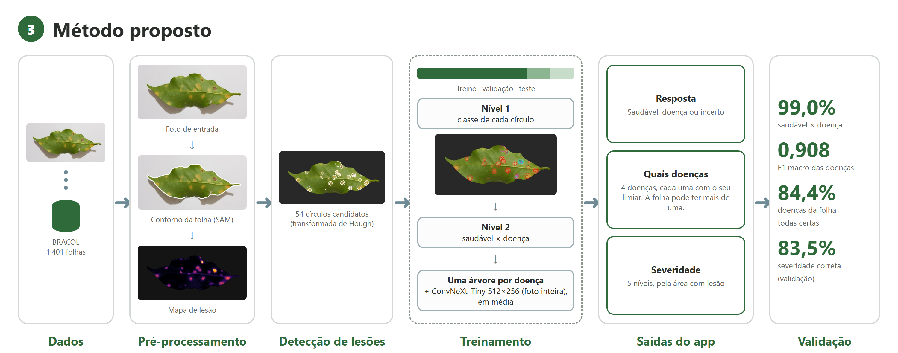

# Doenças do café por foto da folha

Projeto da disciplina **SIN 323 (Inteligência Artificial, UFV, 2026/2)**.

É um aplicativo que roda no seu computador. Você envia a foto de uma folha de café e ele responde:

1. se a folha está **saudável** ou **com doença**;
2. se tiver doença, **quais doenças** aparecem: bicho-mineiro, ferrugem, mancha de phoma ou cercosporiose (a folha
   pode ter mais de uma);
3. a **severidade**, em 5 níveis.

As manchas encontradas aparecem marcadas na foto.

> É um **apoio à decisão**. Não substitui o agrônomo.


Relatório completo: [docs/RELATORIO_FINAL.md](docs/RELATORIO_FINAL.md).

## Como funciona



1. **Contorno da folha.** O SAM, um modelo pronto da Meta, acha a folha na foto.
2. **Mapa de lesão.** Cada ponto da folha recebe uma nota: quanto ele foge do verde da própria folha.
3. **Manchas candidatas.** A transformada de Hough procura manchas redondas nesse mapa (até 60 por folha).
4. **Nota de cada mancha (nível 1).** Um classificador olha a cor, a forma e a textura de cada mancha.
5. **Passo 1: saudável ou doença? (nível 2).** As notas das manchas, junto com medidas da folha inteira, dão a chance
   de a folha ter doença. Se nem "saudável" nem "doença" passar de 60%, a resposta é **"incerto"**.
6. **Passo 2: quais doenças?** Só para folha com doença. Cada doença tem o seu classificador e o seu limiar. Uma rede
   neural, a **ConvNeXt-Tiny**, olha a foto inteira e também dá uma chance para cada doença. O aplicativo usa a
   média das duas respostas.
7. **Severidade.** A parte da folha com cor de lesão, nas faixas de área do BRACOL. Não usa treino.

Nenhuma doença é a "principal": as quatro são tratadas do mesmo jeito.

## Resultados

Números do **conjunto de teste**: folhas que os modelos nunca viram. Entre parênteses, o intervalo de confiança de 95%.

| Pergunta | Folhas | Resultado |
|---|---|---|
| Saudável ou doença? | 201 | acerto de **99,0%** (97,5% a 100%) |
| Quais doenças? | 180 com doença | F1 macro de **0,908** (0,871 a 0,940) |
| Quais doenças? Todas certas na mesma folha | 180 com doença | **84,4%** (78,9% a 90,0%) |

- Por doença (F1 no teste): bicho-mineiro 0,887, ferrugem 0,971, mancha de phoma 0,939 e cercosporiose 0,835.
- Severidade: nível certo em **83,5%** das 200 folhas de validação.

A origem de cada número está em [docs/RESULTADOS.md](docs/RESULTADOS.md).

## Como rodar

Precisa do [Anaconda](https://www.anaconda.com/download) e do Python 3.13. Uma placa de vídeo (GPU) deixa tudo mais
rápido, mas não é obrigatória. No **Anaconda Prompt**, dentro da pasta do projeto:

```bash
conda create -n deteccao-cafe python=3.13 pip
conda activate deteccao-cafe
pip install -r requirements.txt --extra-index-url https://download.pytorch.org/whl/cu128
python -P app/app.py
```

Depois abra <http://127.0.0.1:5000> no navegador. Na primeira foto, o SAM (cerca de 375 MB) é baixado.

- Use fotos de **uma folha destacada, sobre fundo claro**, com a folha no centro.
- Dá para enviar até 12 fotos de uma vez.
- `python -P app/app.py --sem-convnext` responde o passo 2 sem a rede neural (mais rápido, mas acerta menos).

Para rodar os testes automáticos do código (no Linux ou no macOS, troque `set` por `export`):

```bash
set PYTHONPATH=src
python -P -m unittest discover -s tests
```

## Pastas

```text
.
├── README.md
├── requirements.txt
├── app/       aplicativo (Flask)
├── src/       código: Hough, classificadores, ConvNeXt-Tiny e avaliação
├── tests/     testes automáticos
├── models/    modelos usados pelo aplicativo
├── outputs/   resultados de cada etapa
└── docs/      relatórios, telas do aplicativo e figuras
```

## Modelos do aplicativo

| Arquivo | O que faz |
|---|---|
| `models/bracol_hough.joblib` | passo 1: saudável ou doença |
| `models/bracol_doencas.joblib` | passo 2: um classificador por doença e o peso da média com a rede |
| `models/bracol_convnext.pt` | passo 2: ConvNeXt-Tiny |

Os arquivos `models/rocole_*` são de um experimento anterior e não são usados pelo aplicativo.

## Dados

As imagens não fazem parte desta pasta. Os modelos foram treinados no **BRACOL** (folhas de café arábica, licença
CC BY 4.0): <https://data.mendeley.com/datasets/yy2k5y8mxg>. Para treinar de novo, siga o
[relatório final](docs/RELATORIO_FINAL.md#como-reproduzir).

## Limitações

- Os modelos foram treinados e medidos só em folhas destacadas, sobre fundo claro. Fotos tiradas na planta não foram
  medidas.
- Folhas com muito pouca doença podem passar como saudáveis: as 2 que o passo 1 errou no teste tinham só um pouco de
  ferrugem.
- Cercosporiose e bicho-mineiro são as doenças mais difíceis. A cercosporiose aparece quase sempre junto com a
  ferrugem.
- A severidade soma todas as manchas, sem separar por doença, e foi conferida só na validação.
- O teste é pequeno (201 folhas), por isso os intervalos de confiança são largos.

## Trabalhos anteriores

Antes desta versão, o projeto testou uma ConvNeXt-Tiny sozinha no BRACOL e um detector de ferrugem em fotos de campo
(RoCoLe). Esses experimentos estão em [docs/RELATORIO_BRACOL.md](docs/RELATORIO_BRACOL.md) e
[docs/RELATORIO_ROCOLE.md](docs/RELATORIO_ROCOLE.md).

## Autores

- Ana Flávia Tavares Alves
- Laissa Rosa dos Santos
- Raul Suzuki Borges

Universidade Federal de Viçosa, 2026/2
