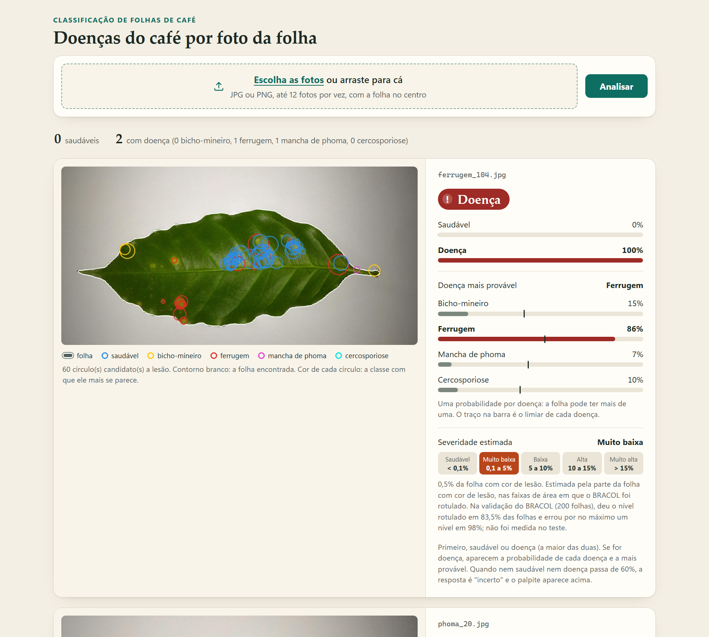

# Doenças do café por foto da folha

Projeto da disciplina **SIN 323 (Inteligência Artificial, UFV, 2026/2)**. Aplicativo local que recebe a foto de uma
folha de café e diz se ela está **saudável ou com doença**. Se tiver doença, mostra **quais doenças** aparecem e a
**severidade** estimada, com as lesões marcadas na foto.

> É um **apoio à decisão**. Não substitui o agrônomo.



Relatório completo: [docs/RELATORIO_FINAL.md](docs/RELATORIO_FINAL.md). Explicação geral do projeto:
[docs/Explicacao_do_Projeto.docx](docs/Explicacao_do_Projeto.docx).

## Resultados

Números do **conjunto de teste**, com imagens que os modelos nunca viram. IC 95% por bootstrap.

| Pergunta | Teste | Resultado | IC 95% |
|---|---|---|---|
| Saudável ou doença? | BRACOL, 201 folhas | acerto **99,5%** | 98,5% a 100% |
| Quais doenças? (bicho-mineiro, ferrugem, mancha de phoma, cercosporiose) | BRACOL, 180 folhas com doença | F1 macro **0,860** | 0,815 a 0,899 |
| Saudável ou doença? (foto de campo, `--modelo rocole`) | RoCoLe, 208 fotos | acerto **96,6%** | 92,3% a 99,1% |

A severidade vem da área da folha com cor de lesão, sem treino. Na validação do BRACOL, deu o nível certo em 83,5%
das 200 folhas. A origem de cada número está em [docs/RESULTADOS.md](docs/RESULTADOS.md).

## Como rodar

Requer o [Anaconda](https://www.anaconda.com/download) e Python 3.13; GPU recomendada. No **Anaconda Prompt**, na raiz
do projeto:

```bash
conda create -n cafe-ferrugem python=3.13 pip
conda activate cafe-ferrugem
pip install -r requirements.txt --extra-index-url https://download.pytorch.org/whl/cu128
python -P app/app.py
```

Depois abra <http://127.0.0.1:5000>. Na primeira análise, o segmentador SAM (cerca de 375 MB) é baixado.

- **Modelo padrão (BRACOL):** folhas destacadas sobre fundo claro.
- **`python -P app/app.py --modelo rocole`:** fotos tiradas na planta (saudável, ácaro-vermelho e ferrugem).
- **"Incerto":** quando nem saudável nem doença passa de 60%, a página mostra o palpite e pede um agrônomo.

Testes, com o ambiente ativado e na raiz do projeto (no Linux ou no macOS, use `export PYTHONPATH=src`):

```bash
set PYTHONPATH=src
python -P -m unittest discover -s tests
```

## Organização da pasta

```text
.
├── README.md
├── requirements.txt
├── app/                     aplicativo local (Flask)
├── src/                     código do detector, do modelo das doenças e da ResNet-50
├── tests/                   testes automáticos
├── models/                  modelos do aplicativo
├── outputs/                 resultados, separados por modelo
└── docs/
    ├── Explicacao_do_Projeto.docx
    ├── RELATORIO_FINAL.md   relatório do produto final
    ├── RESULTADOS.md        números finais e arquivo de origem
    ├── RELATORIO_ROCOLE.md  experimentos no RoCoLe, onde o detector foi criado
    ├── RELATORIO_BRACOL.md  experimento anterior no BRACOL
    ├── SELECAO.md           o que entrou nesta pasta, e por quê
    ├── MANIFESTO.csv        cada arquivo, sua origem e seu SHA-256
    ├── app/                 telas do aplicativo
    └── figuras/             metodologia e arquitetura, em imagem
```

## Modelos

| Arquivo | Modelo | Uso |
|---|---|---|
| `models/bracol_hough.joblib` | detector com a transformada de Hough, treinado no BRACOL | primeiro passo do modelo padrão |
| `models/bracol_doencas.joblib` | um classificador por doença, treinado no BRACOL | segundo passo do modelo padrão |
| `models/rocole_hough.joblib` | detector com a transformada de Hough, treinado no RoCoLe | `--modelo rocole` |
| `models/rocole_resnet50.pt` | ResNet-50 treinada no RoCoLe | `--modelo rocole`, em média com o detector |

## Dados

As imagens não fazem parte desta pasta. Para treinar ou avaliar de novo, baixe os conjuntos (licença CC BY 4.0) e siga
o [relatório final](docs/RELATORIO_FINAL.md#como-reproduzir):

- **BRACOL:** <https://data.mendeley.com/datasets/yy2k5y8mxg>
- **RoCoLe:** Mendeley Data `c5yvn32dzg`

## Limitações

- Cada modelo foi medido só no tipo de foto em que foi treinado. Não há um número que valha para qualquer folha de café.
- Bicho-mineiro e cercosporiose são as doenças mais difíceis (F1 de 0,809 e 0,720 no teste). A cercosporiose aparece
  quase sempre junto com a ferrugem.
- Em fotos de campo, ácaro-vermelho e ferrugem se confundem.
- A severidade foi conferida só na validação do BRACOL. Em fotos de campo, não foi medida.
- Os testes são pequenos, por isso os intervalos de confiança são largos.

## Autores

- Ana Flávia Tavares Alves
- Laissa Rosa dos Santos
- Raul Suzuki Borges

Universidade Federal de Viçosa, 2026/2